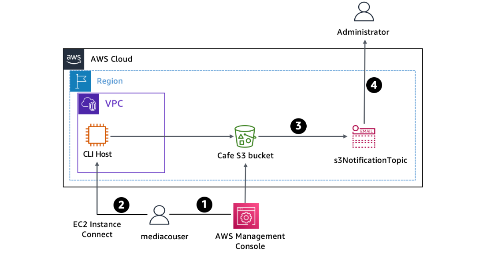
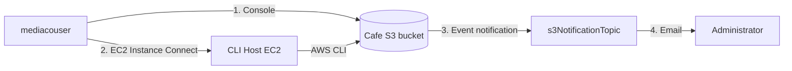
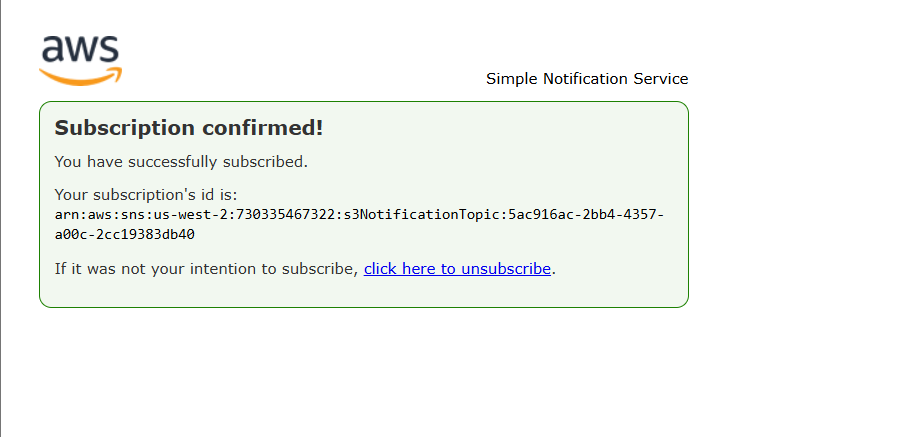
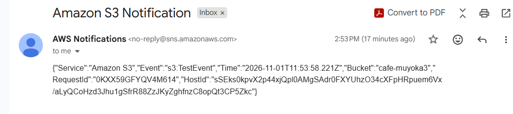
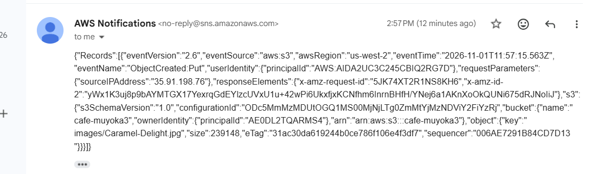
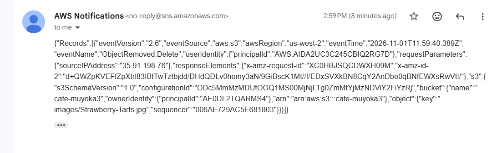

# Secure S3 File Sharing with Event Notifications (AWS CLI, IAM & SNS)

A hands-on AWS lab where I built a secure Amazon S3 bucket for sharing product images with an external media company, restricted their access with IAM, and configured email alerts whenever the bucket contents change.


## Overview

A café needs an external media company to add, update, and delete product pictures in an S3 bucket, without giving them any broader access to the AWS account. An IAM user named `mediacouser` represents the media company's representative. Whenever the bucket's `images/` content changes, Amazon S3 publishes an event to an SNS topic, which emails the administrator.

## Architecture





**Usage flow**

1. A media company representative signs in to the AWS Management Console as `mediacouser` to upload, change, or delete images.
2. Alternatively, `mediacouser` uses the AWS CLI (from the CLI Host EC2 instance) to change the bucket contents.
3. When S3 detects a change, it publishes a notification to the `s3NotificationTopic` SNS topic.
4. The administrator, subscribed to the topic, receives an email describing the change.

## Objectives

- Use the `s3` and `s3api` AWS CLI commands to create and configure an S3 bucket.
- Verify write permissions for a user on an S3 bucket.
- Configure event notifications on an S3 bucket.

## Services & Tools Used

| Service / Tool | Purpose |
|---|---|
| Amazon S3 | Image storage bucket (`cafe-xxxnnn`) |
| AWS IAM | `mediaco` group, `mediaCoPolicy`, and `mediacouser` user |
| Amazon SNS | `s3NotificationTopic` with email subscription |
| Amazon EC2 | CLI Host instance, accessed via EC2 Instance Connect |
| AWS CLI | `aws s3`, `aws s3api`, `aws configure` |
| Region | `us-west-2` |

## Walkthrough

### Task 1: Connect to the CLI Host and configure the AWS CLI
- Connected to the **CLI Host** EC2 instance using **EC2 Instance Connect**.
- Ran `aws configure` with the lab-provided access key, secret key, region `us-west-2`, and output format `json`.

### Task 2: Create and initialize the S3 bucket
- Created a bucket whose name starts with `cafe-` (lowercase letters and numbers only).
- Synced the sample images from `~/initial-images/` to the `images/` prefix.
- Verified the upload with a human-readable listing and summary.

### Task 3: Review IAM permissions and test as `mediacouser`
- Reviewed the **`mediaco`** group's policies:
  - `IAMUserChangePassword` (AWS managed): lets users change their own password.
  - `mediaCoPolicy` (custom), made up of three statements:
    - `AllowGroupToSeeBucketListInTheConsole`: list buckets in the console.
    - `AllowRootLevelListingOfTheBucket`: list first-level objects in the bucket.
    - `AllowUserSpecificActionsOnlyInTheSpecificPrefix`: `GetObject`, `PutObject`, `DeleteObject` (plus version-related actions) only on `cafe-*/images/*`.
- Confirmed `mediacouser` inherits these permissions through group membership.
- Created a CLI access key for `mediacouser` and downloaded the `.csv`.
- Signed in as `mediacouser` in a separate (incognito) browser session and tested:
  - **View:** opened `Donuts.jpg`
  - **Upload:** uploaded a local image into `images/`
  - **Delete:** deleted `Cup-of-Hot-Chocolate.jpg`
  - **Unauthorized:** the bucket **Permissions** tab showed "Insufficient permissions"

### Task 4: Configure S3 event notifications
1. **Created the SNS topic** `s3NotificationTopic` (Standard) and copied its ARN.
2. **Edited the topic access policy** so that the S3 service principal can publish to it, restricted to my bucket with an `aws:SourceArn` condition.
3. **Subscribed an email address** to the topic and confirmed the subscription.
4. **Created `s3EventNotification.json`** on the CLI Host, which publishes `s3:ObjectCreated:*` and `s3:ObjectRemoved:*` events for the `images/` prefix to the topic.
5. **Applied the configuration** with `put-bucket-notification-configuration`.
6. Received the initial `s3:TestEvent` email, confirming the setup worked.

### Task 5: Test notifications using the CLI as `mediacouser`
- Reconfigured the CLI with `mediacouser`'s access keys.
- Tested put, get, delete, and an unauthorized ACL change (see [Results](#results--verification)).

## Key Commands

Replace `<cafe-xxxnnn>` with your bucket name and `<ARN of s3NotificationTopic>` with your topic ARN.

```bash
# Configure the CLI
aws configure

# Create the bucket
aws s3 mb s3://<cafe-xxxnnn> --region 'us-west-2'

# Upload the initial images and verify
aws s3 sync ~/initial-images/ s3://<cafe-xxxnnn>/images
aws s3 ls s3://<cafe-xxxnnn>/images/ --human-readable --summarize

# Attach the event notification configuration
aws s3api put-bucket-notification-configuration \
  --bucket <cafe-xxxnnn> \
  --notification-configuration file://s3EventNotification.json

# Put, get, delete, and an unauthorized ACL change (as mediacouser)
aws s3api put-object --bucket <cafe-xxxnnn> --key images/Caramel-Delight.jpg --body ~/new-images/Caramel-Delight.jpg
aws s3api get-object --bucket <cafe-xxxnnn> --key images/Donuts.jpg Donuts.jpg
aws s3api delete-object --bucket <cafe-xxxnnn> --key images/Strawberry-Tarts.jpg
aws s3api put-object-acl --bucket <cafe-xxxnnn> --key images/Donuts.jpg --acl public-read
```

### SNS topic access policy

```json
{
  "Version": "2008-10-17",
  "Id": "S3PublishPolicy",
  "Statement": [
    {
      "Sid": "AllowPublishFromS3",
      "Effect": "Allow",
      "Principal": { "Service": "s3.amazonaws.com" },
      "Action": "SNS:Publish",
      "Resource": "<ARN of s3NotificationTopic>",
      "Condition": {
        "ArnLike": { "aws:SourceArn": "arn:aws:s3:*:*:<cafe-xxxnnn>" }
      }
    }
  ]
}
```

### S3 event notification configuration (`s3EventNotification.json`)

```json
{
  "TopicConfigurations": [
    {
      "TopicArn": "<ARN of s3NotificationTopic>",
      "Events": ["s3:ObjectCreated:*", "s3:ObjectRemoved:*"],
      "Filter": {
        "Key": {
          "FilterRules": [
            { "Name": "prefix", "Value": "images/" }
          ]
        }
      }
    }
  ]
}
```

## Results & Verification

| Test | Action | Expected result | Outcome |
|---|---|---|---|
| Put | Upload `Caramel-Delight.jpg` | Returns an ETag; email with `ObjectCreated:Put` | ✅ |
| Get | Download `Donuts.jpg` | Succeeds; **no** email (GET is not a configured event) | ✅ |
| Delete | Delete `Strawberry-Tarts.jpg` | Email with `ObjectRemoved:Delete` | ✅ |
| Unauthorized | `put-object-acl --acl public-read` | `AccessDenied` | ✅ |
| Console (unauthorized) | Open bucket **Permissions** tab as `mediacouser` | "Insufficient permissions" | ✅ |

## Security Considerations

- **Least privilege:** `mediacouser` can only read, write, and delete objects under `images/`. It cannot change bucket permissions or ACLs.
- **Group-based access:** permissions are attached to the `mediaco` group rather than the individual user, which makes them easier to manage as users join or leave.
- **Scoped SNS policy:** only the S3 service, and only for my specific bucket (via `aws:SourceArn`), can publish to the topic.
- **Prefix-scoped notifications:** only events under `images/` trigger alerts.
- **Credential hygiene:** access keys and the downloaded `.csv` are never committed to the repo. In a real environment, prefer short-lived credentials and rotate or delete unused keys.

## Key Takeaways

- Combining IAM groups and prefix-scoped policies gives external users just enough access.
- The `s3` commands are convenient for bulk operations (`mb`, `sync`, `ls`), while `s3api` exposes lower-level operations (`put-object`, `delete-object`, notification configuration).
- S3 event notifications need two things to work: a notification configuration on the bucket, and a resource policy on the SNS topic that allows S3 to publish.
- Testing the **denied** paths matters as much as testing the allowed ones.


## Screenshots

### Architecture


### SNS subscription confirmed


### S3 test event notification


### Object upload notification (`ObjectCreated:Put`)


### Object deletion notification (`ObjectRemoved:Delete`)



